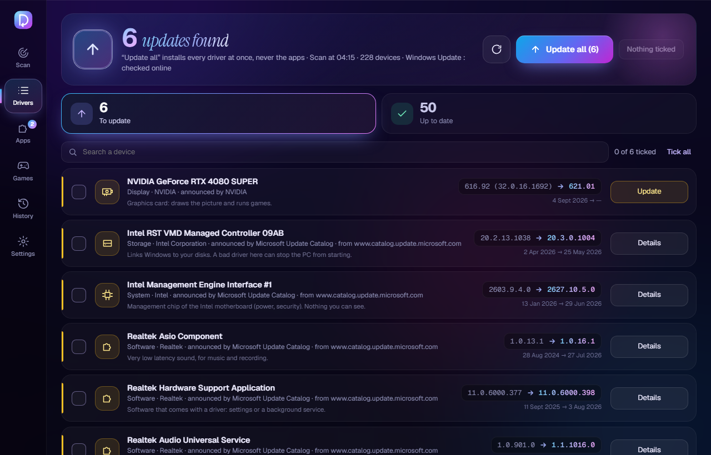

# Drivn

**Your drivers and apps, up to date. From official sources only.**

Drivn scans your Windows PC, finds the newer versions that really fit your hardware,
shows you exactly where each one comes from, and updates everything in one pass,
with a restore point, a backup of each driver and a one-click rollback.

**Free · No ads · No account · No telemetry · No bundled software**

[**Download Drivn 1.0.0**](https://github.com/1oma1e/Drivn/releases/latest)

---

## Why Drivn

Most driver updaters are opaque: they install files from unknown mirrors, push "optimizers" and nag you to pay. Drivn is the opposite.

| | |
|---|---|
| 🔎 **Exact match** | A driver is offered only when one of its hardware IDs is *equal* to one of your device's IDs, and only when it is really newer: never a downgrade, never a generic driver passed off as better. |
| 🏛️ **Official sources only** | Windows Update, the Microsoft Update Catalog, NVIDIA, ASUS, Oracle and winget. No driver packs, no mirrors. A source that is not on the list does not exist for Drivn. |
| 🔍 **Full transparency** | Before you install anything, each line says where it comes from: the exact download host, the publisher, the versions and the dates. |
| ⚡ **One click, one pass** | *Update all* installs every driver of the tab in one pass, with a single Windows permission prompt. NVIDIA's official package runs silently inside the pass. |
| 🛟 **Always a way back** | A restore point before each pass, a backup of each driver before it is replaced, and a rollback button for each driver in the history. |
| 🗣️ **Plain words** | Every screen explains itself, with help bubbles on the technical words. English and French. |

## Where updates come from

| Source | What it finds | How it is installed |
|---|---|---|
| **Windows Update** | Drivers Microsoft publishes for your devices | By Windows Update itself, one driver at a time |
| **Microsoft Update Catalog** | Newer drivers from the hardware makers (Intel, Realtek…) | The package is downloaded, its SHA-256 and Microsoft signature checked, then Windows installs its driver |
| **NVIDIA** | The latest GeForce driver for your card | NVIDIA's own installer, signature checked, run silently |
| **winget** | Newer versions of your applications | winget, which checks each installer's hash |
| **ASUS** | Your motherboard's latest BIOS | Shown only: Drivn never flashes a BIOS |
| **Oracle** | The latest Java 8 | Java's own updater |

## How a pass works

1. **Scan** (about a minute, read-only, no administrator rights): devices, drivers, BIOS, applications.
2. **Choose** what to update, or click **Update all**.
3. Drivn asks whether to **create a restore point** (yes by default), then Windows asks for **administrator permission** once.
4. For each driver: check it again against the device, **back up** the current driver, **install**, read the device again, **check the signature**.
5. Publishers' installers (NVIDIA), then applications (winget), in the same pass.
6. **A failure never stops the pass**: it is written down with its reason and the pass goes on.
7. The end screen tells, line by line, what was done, what failed and why. Every step is in the pass journal.

Every step without a percentage (Windows Update, winget, an installer) shows the time spent, so you always know Drivn is working.

## Safety

- **Restore points**: one at every pass (when you say yes). Drivn keeps its **5 latest** and deletes the oldest of **its own**; it never touches a point made by Windows or anyone else.
- **Driver backups**: kept for the last 5 passes; **rollback driver by driver** from the history.
- **Checked files**: the digital signature of every package Drivn downloads, and its hash whenever the source publishes one (Microsoft Update Catalog, Intel); a file signed by someone unexpected is refused, with no way to force it.
- **Separated rights**: the app never runs as administrator. A small separate installer does the changes, re-checks everything itself, and trusts nothing the interface sends.
- **Never older, never generic**: a version older than yours is never installed; a driver too generic for your device is refused.
- **Nothing hidden**: what Drivn could not check, could not install or did differently is always said, with its reason.

## Install

1. Download `Drivn_1.0.0_x64-setup.exe` from the [latest release](https://github.com/1oma1e/Drivn/releases/latest).
2. Run it and accept the Windows permission prompt: Drivn goes to `C:\Program Files\Drivn`, where only administrators can change its files.
3. The setup is not code-signed yet, so Windows SmartScreen may say *"Windows protected your PC"*: click **More info**, then **Run anyway**.

**Requirements**: Windows 11 (64-bit), an internet connection, **winget** for applications (the *App Installer*, built into Windows 11), and **System Protection** turned on for `C:` so restore points can be made.

Drivn updates itself: when a new version is published here, an **Update** button appears in the app. The new setup is checked against Drivn's signing key before it runs.

## Good to know

- Close an application before updating it: winget cannot update an application that is open.
- NVIDIA's installer restarts the graphics driver: your screens may go black for a few seconds. This is normal.
- Drivn never restarts your PC by itself: it asks, when a driver needs it.
- **Intel** and **MSI** websites block automated tools; Drivn does not bypass them. Their drivers come through Windows Update and the Microsoft Update Catalog.
- **AMD** graphics drivers are shown, not installed yet.
- Drivn cannot roll back an application or NVIDIA's package by itself: the restore point covers them.

## Privacy

Drivn has no account, no ads and no telemetry. To find updates it sends only what each source needs (device IDs, versions) to the sources listed above, and checks GitHub for a newer Drivn. Scan results and pass journals stay on your PC, in `C:\ProgramData\Drivn`.

## Built with

Rust · Tauri 2 · plain JavaScript (no framework) · the Windows APIs (Windows Update Agent, SetupAPI, WinVerifyTrust, System Restore). About 19 000 lines of Rust and JavaScript, 176 automated tests.

## License

Copyright © 2026 **1oma1e**. **All rights reserved.**

The source code is published **for reading only**. Without written permission from 1oma1e you may not copy, modify, redistribute, publish or reuse it, in whole or in part, nor use it to train AI models. The only use allowed is to install and run, for yourself, the official setup published on the [Releases](https://github.com/1oma1e/Drivn/releases) page. The software is provided "as is", without warranty. Full text: [LICENSE](LICENSE). Third-party components keep their own licenses: [THIRD-PARTY-NOTICES.md](THIRD-PARTY-NOTICES.md).

---

<b>En français</b>

**Drivn met à jour tes drivers et tes applis, depuis les sources officielles uniquement.** Il scanne ton PC, trouve les versions plus récentes vraiment faites pour ton matériel, montre d'où vient chacune, et installe tout en une passe, avec un point de restauration, une sauvegarde de chaque driver et un retour arrière en un clic.

- Gratuit, sans pub, sans compte, sans télémétrie.
- Sources : Windows Update, Microsoft Update Catalog, NVIDIA, ASUS, Oracle, winget.
- Garde ses 5 derniers points de restauration (jamais ceux des autres) et les sauvegardes de ses 5 dernières passes.
- Interface en français et en anglais (Réglages → Langue).
- Installation : télécharge `Drivn_1.0.0_x64-setup.exe` dans les [Releases](https://github.com/1oma1e/Drivn/releases/latest). Si SmartScreen bloque : **Informations complémentaires** → **Exécuter quand même**.

Code visible pour être lu seulement, tous droits réservés (voir [LICENSE](LICENSE)).

